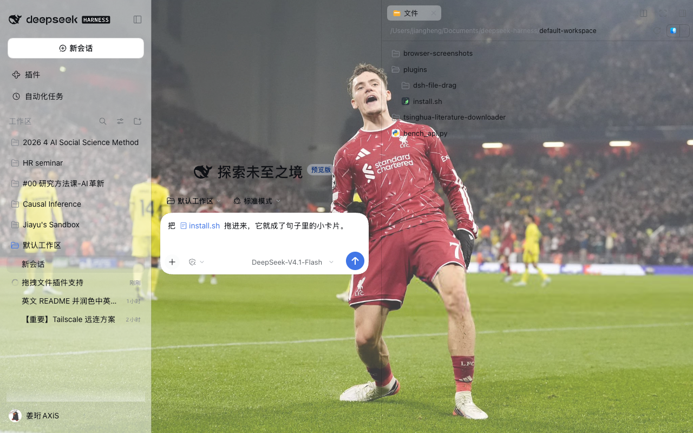

# dsh-file-drag

Drag files and folders from the DeepSeek Harness **Files** sidebar straight into the message composer. By default each dropped file becomes a small inline chip inside the sentence you are writing — the same rounded token the composer's own `@` picker produces — and you can switch that to an uploaded attachment or a plain `@` path.

DeepSeek Harness already accepts file drags that come from the operating system, but its Sidebar Files pane has no drag source at all, and the composer only claims drags whose payload type is `Files`. This plugin closes that gap from the outside: it arms the existing file rows, carries the relative path over a private MIME type, and then hands the result to the composer through its own insertion paths.



## Requirements

- DeepSeek Harness **0.2.1-rc.2** or a build that still renders the right sidebar Files tab.
- The `desktop` profile (`~/.dsh/profiles/desktop`), which is what the macOS app uses.

## Install

```bash
git clone https://github.com/JiayuREN1127/dsh-file-drag.git
cd dsh-file-drag
./install.sh
```

`install.sh` copies the package into `~/.dsh/profiles/desktop/node_modules/dsh-file-drag` and appends one Loader row to `~/.dsh/profiles/desktop/cordis.patch.yml`, keeping a timestamped backup of that file first.

To install by hand, do the same two things:

1. Copy this package to `~/.dsh/profiles/desktop/node_modules/dsh-file-drag`.
2. Append to `~/.dsh/profiles/desktop/cordis.patch.yml`:

```yaml
- insert:
    - id: file-drag
      name: dsh-file-drag
```

Then **quit the app completely (`Cmd-Q`) and reopen it**. The Loader tree is built at startup, so a page reload is not enough for the first install. Later plugin updates only need a page reload.

## Usage

1. Open the **Files** tab in the right sidebar.
2. Press and drag a file or a folder onto the message composer.
3. Release.

While dragging, the composer shows a dashed outline so you know it will accept the drop.

### Drop behaviour

Pick it in **Settings → General → File drag**:

| Mode | Result |
|---|---|
| **Inline chip** (default) | A small rounded card with the file icon and name lands in the sentence, exactly where the caret is. It is the composer's own reference token, so it moves, wraps and deletes like text. |
| **Attachment** | The file is read and uploaded, and appears in the attachment rail above the composer. |
| **@ path** | The relative path is inserted as plain text, e.g. `@src/client/index.ts`. |

Hold **Alt (⌥)** while dropping to get the plain `@` path once, without changing the setting.

The preference is stored per client under the `dsh-file-drag:mode` key in `localStorage`.

| Source row | Inline chip | Attachment | @ path |
|---|---|---|---|
| `src/client/index.ts` | chip labelled `index.ts` | uploaded card | `@src/client/index.ts ` |
| folder `packages` | chip labelled `packages/` | falls back to a chip | `@packages/ ` |
| `my notes.md` | chip labelled `my notes.md` | uploaded card | `@"my notes.md" ` |

Paths keep the composer's own `formatFileMention` grammar: folders end with a slash and whitespace is quoted. A chip that cannot be placed falls back to the `@` path form, so a drop is never silently lost.

## How it works

**Drag source.** The Files tab renders every row as `<li data-files-entry="file|directory|other" data-files-path="relative/path">`. The plugin does not guess the tree shape: on `pointerdown` it sets `draggable` on the closest such row, so the press can turn into a drag.

**Transport.** `dragstart` writes a private payload, `application/x-dsh-file-path`, holding the relative path and the entry kind. The native `Files` type is deliberately not used for the drag itself, because a synthesized `File` has no host path and the desktop path bridge would reject it.

**Inline chip.** On drop the plugin reaches the resident composer shell for the session and calls its `addFiles` with one reference — the same call the composer makes when you pick a file from the `@` menu — so the full Lexical decorator node, icon, label and clipboard projection all come from DeepSeek Harness itself. The session-scoped `conversation` service is reached through `ctx.sessions.binding(id).ctx.get("conversation")`, because a root-level plugin cannot inject a session-scoped service.

**Attachment.** The plugin reads the file through the `workspaceFiles` client Remote (`readBytes`), wraps the bytes in a real `File`, and replays the built-in `Files` drop onto the composer. The composer then takes its own upload path, so the card behaves exactly like one dragged in from the operating system.

**@ path.** The mention is delivered as a synthetic `paste` event carrying `text/plain` on the editor root. The draft editor is Lexical, which ignores direct DOM writes and `document.execCommand`; a paste is the only reliable way in.

**Settings row.** The preference is a row registered into the `settings.general.item` slot, so it appears in DeepSeek Harness's own Settings page and follows the UI language.

## Compatibility

Built against DeepSeek Harness `0.2.1-rc.2`. The plugin depends on implementation details that are not a public contract:

- the `data-files-entry` / `data-files-path` attributes on sidebar rows,
- the composer being a `[contenteditable="true"]` element that handles `paste`,
- the composer component carrying a `sessionId` prop,
- the `settings.general.item` settings slot and the `conversation` service face,
- `window.__ModuleLoader__.load` as the client bundle entry point.

If a future release changes any of these, the plugin degrades instead of breaking the page: every handler is guarded, a failed chip insertion falls back to the `@` path, and `apply` is wrapped so a failure never blocks boot.

## Limitations

- One item per drag; multi-select dragging is not implemented.
- Only works while the Files tab is rendered, because the rows are the drag source.
- Drops are accepted anywhere in the window, not only over the composer.
- Attachment mode reads files through the workspace-files Remote, so it inherits that service's size limit; oversized files fall back to a chip.
- The mention is relative to the Files tab root, which is the session workspace. A session opened in another folder still receives the same relative path.

## Uninstall

```bash
rm -rf ~/.dsh/profiles/desktop/node_modules/dsh-file-drag
cp ~/.dsh/profiles/desktop/cordis.patch.yml.bak-<timestamp> ~/.dsh/profiles/desktop/cordis.patch.yml
```

Then restart the app.

## License

MIT
